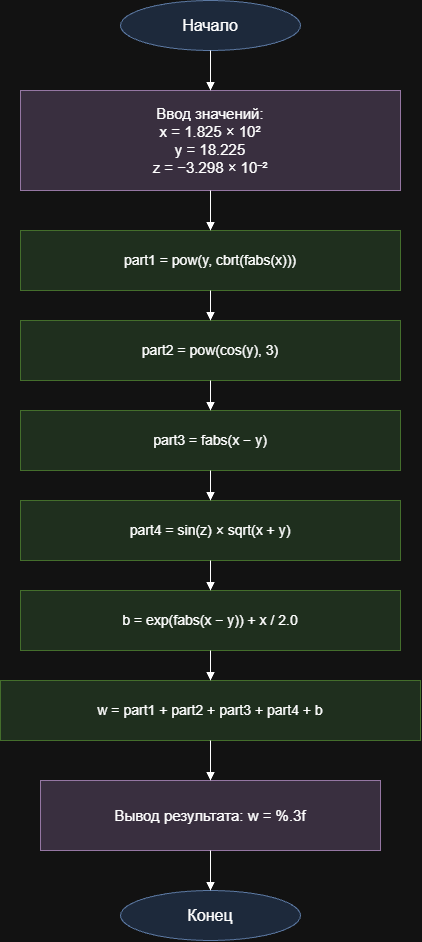

#                   **Домашнее задание к работе 5**

## Условие задачи

Вычислить значение функции `b` при заданных значениях `x`, `y`, `z`:

Исходные значения:

- `x = 1.825 × 10² = 182.5`
- `y = 18.225`
- `z = −3.298 × 10⁻² = −0.03298`

## 1. Алгоритм и блок схема

- **Инициализация:** Подключение библиотек `math.h` и `stdio.h`, ввод исходных данных: `x = 182.5`, `y = 18.225`, `z = -0.03298`.
- **Расчёт 1-го слагаемого:** Вычисление значения `y^(cbrt(fabs(x)))` с помощью функций `fabs`, `cbrt` и `pow`.
- **Расчёт числителя:** Вычисление `cos(y)^3`, модуля разности `|x - y|` и выражения `1 + sin(z)^2 / sqrt(x + y)` с использованием функций `cos`, `fabs`, `sin`, `sqrt` и `pow`. Перемножение полученных значений.
- **Расчёт знаменателя:** Вычисление суммы `exp(fabs(x - y)) + x / 2` с помощью функций `exp` и `fabs`.
- **Финальный расчёт:** Деление числителя на знаменатель, прибавление результата к первому слагаемому и запись итогового значения в переменную `b`.
- **Вывод результата:** Печать исходных данных, числителя, знаменателя и полученного значения `b` в консоль с форматированием `%.4f`.
- **Конец.**

## Блок-схема алгоритма

[Открыть блок-схему](images/block_scheme.png)

## 2. Реализация программы

## 3. Результат работы программы
После успешного выполнения программа выводит в консоль одну строку со значением вычисленного математического выражения: b = 1.2131

## Информация о разработчике 
                                Запорин Артём, бТИИ-262

